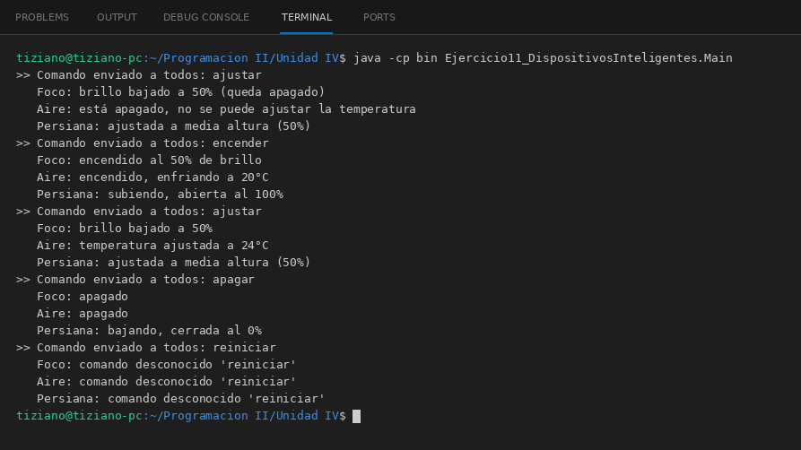

# Controlable

Programación II - Unidad 4 - Ejercicio 11

## Consigna
Enviar un mismo comando a todos los artefactos de una casa inteligente y que cada uno responda a su manera.

## Lógica
- Interfaz `Controlable` con `String ejecutarAccion(String comando)`.
- `FocoInteligente`, `AireAcondicionado` y `PersianaMotorizada` guardan su estado y reaccionan a `encender`, `apagar` y `ajustar`; rechazan comandos desconocidos (el aire no se ajusta apagado).
- `HubCentral` mantiene la lista de dispositivos y envía el comando a todos de forma polimórfica.
- `Main`: secuencia de comandos y el estado resultante de cada aparato.

## Ejecución

